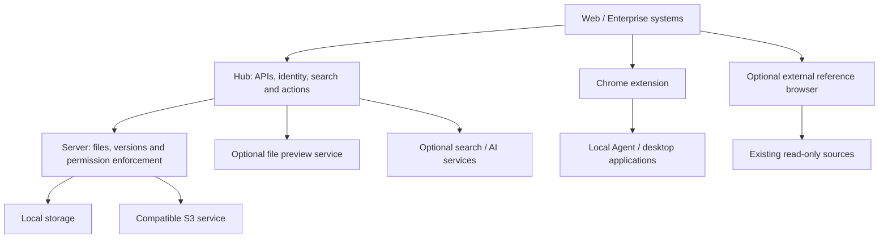

# Architecture

[English](../en/architecture.md) | [简体中文](../zh-CN/architecture.md)

[Product home](../../README.md) · [Documentation](README.md)

The Core combines the Seafile file engine, Hub Web/API and CloudFile extensions. Docker packages and deploys the components. Enterprise systems consume file capabilities through authenticated APIs; they keep their own workflows and business models.

## Optional Capability Groups

| Name | Role | Boundary |
| --- | --- | --- |
| CF-Storage | Local and S3 storage classes | Uses existing storage routing; RustFS compatibility follows release validation |
| CF-Fileview | Enhanced previews using eap-fileview | Source system authorizes reads; viewer does format conversion |
| CF-Explorer | External reference access using Filestash | Source credentials and server rules enforce read-only roots |
| CF-Agent | Local applications, editing and submission | Separate desktop lifecycle; session and server checks control operations |

These are capability names, not four mandatory new services. CF-Storage reuses existing backends; Fileview and Explorer integrate independent tools; Agent is a separately installed client.

## Data And Authorization

File versions and permissions remain authoritative in the file platform. Search indexes, preview caches and AI results are derived data. A search result, embedded URL or resource key does not grant access. Source access must be checked when reading or publishing files; optional service failures must not widen permissions.

Technical details: [Server (Chinese)](https://github.com/eaopen/cloudfile-server/blob/dev/doc/README.md), [Hub (Chinese)](https://github.com/eaopen/cloudfile-hub/blob/dev/docs/README.md), [deployment architecture (Chinese)](https://github.com/eaopen/cloudfile-docker/blob/dev/docs/architecture.md).
