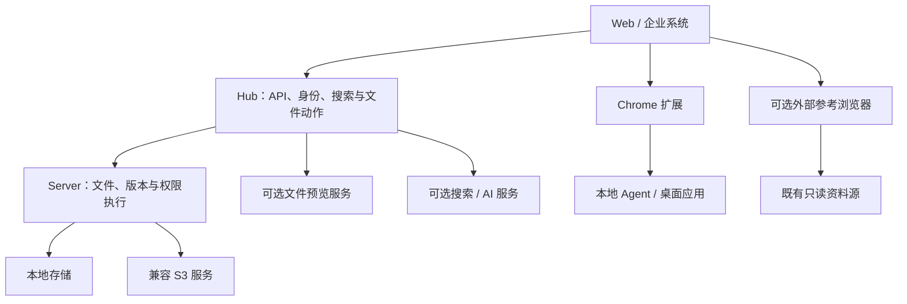

# 产品架构

[English](../en/architecture.md) | [简体中文](../zh-CN/architecture.md)

[产品首页](../../README.zh-CN.md) · [文档导航](README.md)

Core 由 Seafile 文件引擎、Hub Web/API 和 CloudFile 扩展组成，Docker 负责构建部署。企业系统经认证 API 消费文件能力，保留自己的业务流程与模型。

## 可选增强能力

| 名称 | 职责 | 边界 |
| --- | --- | --- |
| CF-Storage | 本地与 S3 存储类 | 复用存储路由，RustFS 兼容以发行验证为准 |
| CF-Fileview | 集成 eap-fileview 增强预览 | 来源系统授权取流，查看器转换格式 |
| CF-Explorer | 复用 Filestash 访问参考资料 | 来源凭据与服务端规则保证只读根 |
| CF-Agent | 本地应用、编辑与提交 | 独立桌面生命周期，操作受会话及服务端校验约束 |

这些名称表示能力分组，不要求新建四套服务。CF-Storage 复用已有后端；Fileview、Explorer 接入独立工具；Agent 单独安装。

## 数据与授权

文件平台中的版本与权限是权威事实，搜索索引、预览缓存和 AI 结果是派生数据。搜索命中、嵌入 URL 和资源键不授予访问权；读取或发布时仍须校验来源权限，可选服务故障不得扩大权限。

技术参考：[Server](https://github.com/eaopen/cloudfile-server/blob/dev/doc/README.md)、[Hub](https://github.com/eaopen/cloudfile-hub/blob/dev/docs/README.md)、[部署架构](https://github.com/eaopen/cloudfile-docker/blob/dev/docs/architecture.md)。
